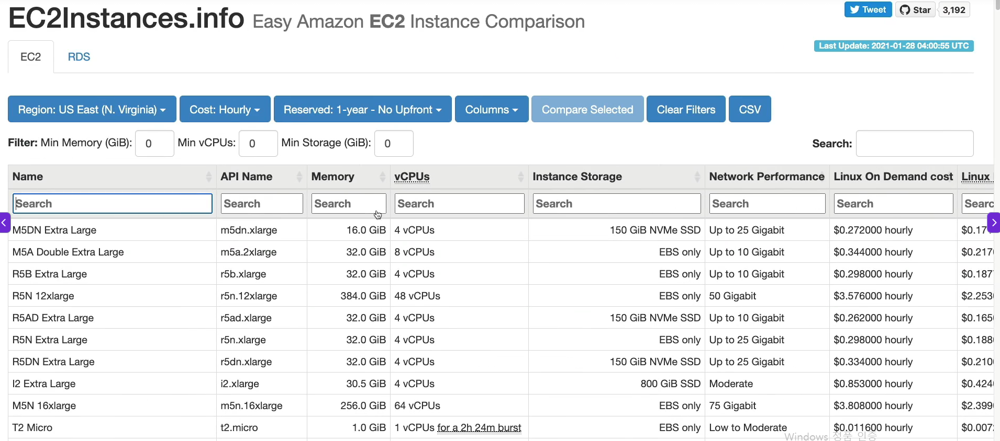
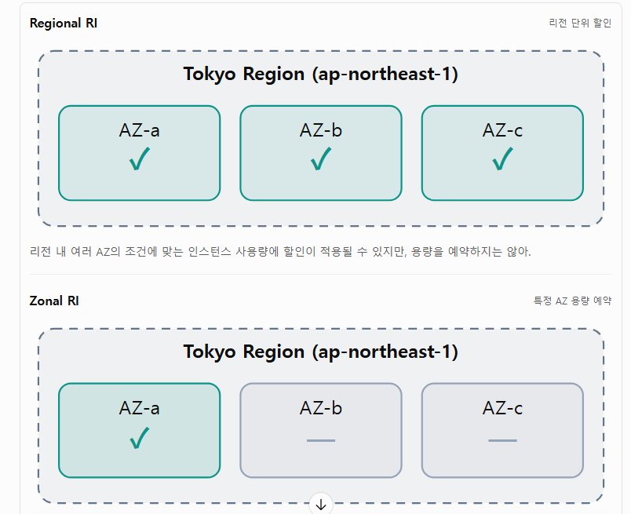

## 33. Create an EC2 Instance with EC2 User Data to have a Website Hands On
EC2 - Instances - Launch instances

Create Key Pair
- .pem : window10 이상 
- .ppk : window10 미만 선택

## 34. Create an EC2 Instance with EC2 User Data to have a Webstie Hands on
instance를 재실행할때마다 Public IPv4 address는 바뀌고
Private IPv4 addresses 는 고정이다.
http로 생성했으면 https로는 못들어간다.

## EC2 Instance Types Basics
7개 종류의 인스턴스가 있음

1. General Purpose
- Greate for a diversity of workloads such as web servers or code repositories
- Balance between
  - Compute
  - Memory
  - Networking
- In the course, we will be using the t2.micro which is a General Purpose EC2 instance

2. Compute Optimized
- Greate for compute-intensive tasks that require high performance processors
  - Batch processing workloads
  - Media transcoding
  - High performance web servers
  - High performance computing (HPC)
  - Scientific modeling & machine learning
  - Dedicated gaming servers

3. Memory Optimized 
- Fast performance for workloads that process large data sets in memory
- Use cases 
  - High performance, relational/non-relational databases
  - Distribute web scale cache stores (ex.ElastiCache = 자주 쓰는 데이터를 잠깐 복사해두는 초고속 저장소)
  - In-memory databases optimized for BI (business intelligence)
  - Applications performing real-time processing of big unstructured data

4. Storage Optimized
- Greate for storage-intensive tasks that require high, sequential read and write access to large data seets on local storage
- Use cases
  - High frequency online transaction processing(OLTP)systems
  - Relational & NoSQL databases
  - Cache for in-memory databases (ex.Redis)
  - Distribured file systmes

ec2instances.info : 모든 ec2인스턴스를 비교할 수 있는 사이트.

## Security Groups & Classic Ports Overview
- Security groups are acting as a "firewall" on EC2 instances
- They regulate 
  - Access to Ports
  - Authorised IP ranges - IPv4 and IPv6
  - Control of inbound network (from other to the instance)
  - Control of outbound network (from the instance to other)

### Securiy Groups Good to know
- Can be attached to multiple instances
- Locked down to a region / VPC combination
- Does live "outside" the EC2 - if traffic is blocked the EC2 instance won't see it
- It's good to maintain one separate secutiy group for SSH access
(SSH처럼 민감한 관리용 접근은 별도의 Security Group으로 분리해서 관리하는 것이 좋은 운영 방식이다)
+요즘 AWS에서는 가능하면 22번 SSH 포트 자체를 열지 않고 AWS Systems Manager Session Manager를 사용하는 방법도 많이 써. 그러면 22 inbound 규칙이 아예 필요 없어서 더 안전해.
- If your application is not accessible(time out), then it's a security group issue
- If your application gives a "connection refused" error, then it's an application error or it's not launched
- All inbound traffic is blocked by default
- All outbound traffic is authorised by default

### Classic Ports to know
- 22 : SSH (Secure Shell) - log into a Linux instance
- 21 = FTP (File Tranasfer Protocol) - upload files into a file share
- 22 = SFTP (Secure File Transfer Protocol) - upload files using SSH
- 80 = HTTP - access unsecured websites
- 443 = HTTPS - access secured websites
- 3389 = RDP (Remote Desktop Protocol) - log into a Windows instance

## 37. SSH Overview

SSH란?
다른 컴퓨터/서버에 원격으로 접속해서 명령어를 실행하는 방식
특히 EC2에서는 Linux 서버에 접속할 때 거의 기본처럼 사용
ex) ssh -i my-key.pem ec2-user@12.34.56.78

pem은 security키 인데, instance를 만들 때 security key를 추가하는 란이 있음.
이 key는 처음 생성할 때 한 번만 저장할 수 있으며 다시 다운 불가함.

만약 instance에 key가 하나만 설정되어있고, 그 key를 잃어버렸으면 instance를 다시 만들어야하고
기존 키로 접속할 수 있으면, 접속 후 key를 추가할 수 있음

원격환경 나가는 keyword : exit

## 42. EC2 Instance Connect
Insance - Connect

- EC Instance Connect
: 웹으로 들어감. 접속 시 임시 SSH키를 생성해서 접속해주기 때문에 기존 SSH키 필요없음
따라서 ssh기본포트인 22가 열려있지 않으면 웹 접속 불가능

## 43. EC2 Instance Roles Demo
EC2 Instance에 절대로 개인정보를 넣지 말 것.
같은 계정의 다른 유저가 다 확인 할 수 있음.

대신 Rolese을 EC2에 붙여서 cridential을 제공함  

Instances - Action - Security - Modify IAM role 

## 44. EC2 Instance Purchasing Options
- On-Demand Instances - short workload, predictable pricing, pay by second
- Reserved (1 & 3 years)
  - Reserved Instance - long workloads
  - Convertible Reserved Instances - long workloads with flexible instances
- Saving plans (1 & 3 years) - commitment to an amount of usage, long workload
- Spot Instances - short workloads, cheap, can lose instances (less reliable)
- Dedicated Hosts - boo an entire physical server, control instance placement
- Dedicated Instances - no other customers will share your hardware
- Capacity Reservations - reserve capacity in a speciic AZ for any duration

1. EC2 On Demand
- Pay for what you use : 
  - Linux or Windows - billing per second, after the first minute
  - All other operating systems - billing per second
- Has the highest cost but no upfront payment
- No long-term commitment

- Recommended for short-term and un-interrupted workloads where you can't predict how the application will behave (Auto Scaling)
Short-term workloads (단기 작업), Uninterrupted workloads (중단되면 안 되는 작업)

2. EC2 Reserved Instances
- Up to 72% discount compared to On-demand
- You reserve a specific instancce attributes (Instance Type, Region, Tenancy, OS)
- Reservation Period - 1 Year(+discount) or 3 years (+++discount)
- Payment Options - No Upfront(+), Partial Upfront(++), All Upfront(+++)
- Reserved Instance's Scope - Regional or Zonal (reserve capacity in an AZ)
- Recommended for steady-state uasgae applications (think database)
- You can buy and sell in the Reserved Instance Marketplace

- Convertible Reserved Instance
  - Can change the EC2 instance Type, instance family, OS, scope and tenancy

1. Reserved Instances는 서버를 예약하는 것인가, 가격 할인을 예약하는 것인가?

2. Standard RI와 Convertible RI는 무엇이 다른가?

3. Regional RI와 Zonal RI는 무엇이 다른가?

4. 1년/3년 약정과 결제 방식은 비용에 어떤 영향을 주는가?

중요한 점: RI는 별도의 EC2 서버가 아니다
Reserved Instance는 기본적으로 EC2 인스턴스에 자동으로 적용되는 요금 할인 혜택이야.
예를 들어 현재 m5.large Linux 서버가 이미 실행 중이라면, 조건이 일치하는 RI를 구매하는 것으로 요금 할인을 받을 수 있어.
RI를 구매한다고 새로운 EC2가 자동 생성되는 것은 아니야.

Standard RI
최대 72%
더 높은 할인율

Convertible RI
최대 66%
더 높은 변경 유연성

속성	설명	예시
Instance Type	EC2 사양	m5.large
Region	AWS 리전	ap-northeast-1 (Tokyo)
Tenancy	물리 서버 공유 여부	Default / Dedicated
OS (Platform)	운영체제	Linux / Windows
Scope	할인 적용 범위	Regional / Zonal
Instance Type
EC2의 CPU와 메모리 사양을 의미해.
예를 들어 t3.medium, m5.large, c6i.xlarge처럼.
Standard RI에서는 기본적으로 일치하는 인스턴스 사양이 필요하지만, 특정 Regional RI에는 같은 인스턴스 패밀리 안에서 크기가 달라도 할인이 적용되는 Instance Size Flexibility 기능이 있어.
따라서 모든 RI가 반드시 정확히 같은 인스턴스 타입에만 적용되는 것은 아니야.
Region
RI를 구매한 리전을 의미해.
예를 들어 Tokyo 리전용 RI를 구매했다면 Singapore 리전의 EC2에는 적용할 수 없어.
Tenancy
EC2가 사용하는 물리적 하드웨어의 공유 방식을 의미해.
- Default: 다른 AWS 고객과 물리적 서버를 공유할 수 있음
- Dedicated: 단일 고객 전용 하드웨어에서 실행
OS
Linux인지 Windows인지와 같은 플랫폼 조건이야.
기본적으로 구매한 RI의 플랫폼과 실행 중인 EC2의 플랫폼이 일치해야 할인받을 수 있어. 

Regional RI
예를 들어 Tokyo 리전에서 Regional RI를 구매했다고 가정하자.
해당 리전 내에서 일치하는 EC2를 실행하면 AZ가 달라도 할인받을 수 있어.
하지만 특정 AZ에 EC2를 생성할 수 있도록 용량을 확보해 주지는 않아.
Zonal RI
Zonal RI는 특정 Availability Zone의 용량까지 예약해.
예를 들어 ap-northeast-1a에 m5.large 인스턴스 1개를 예약했다면 그 AZ에서 해당 사양의 인스턴스를 실행할 수 있도록 용량이 확보되는 거야.
중요한 것은 할인뿐만 아니라 **Capacity Reservation (용량 예약)**을 제공한다는 점이지.
비교	Regional RI	Zonal RI
적용 범위	Region	특정 AZ
할인	O	O
Capacity Reservation	X	O
AZ Flexibility	O	X
Instance Size Flexibility	조건부 O	X

3. EC2 Savings Plans
  - Get a discount based on long-term usage
  - Commit to a certain type of usage
  - Usage beyond EC2 Savings Plans is billed at the On-Demand price
  - Locked to a specific instance family & AWS region
  - Flexible across:
    - Instance Size
    - OS

4. EC2 Spot Instances
  - Can gget a discount of up to 90% 
  - Instances that you can "lose" at any point of time if your max prices is less than the current spot price
  - The MOST cost-efficient instances in AWS
  - Useful for workloads that are resilient to failure
    - Batch jobs
    - Data analysis
    - Image processing
    - Any distributed workloads
    - Workloads with a flexisble start and end time

- Not suitable for critical jobs or databases

5. EC2 Dediceated Hosts
  - A physical server with EC2 instance capacity fully dedicated to your use
  - Allows you address compliance requirements and use your existing server-bound software licenses
  (per-socket, per-core, pe-VM software licenses)
  